# Errand · Life Admin Agent

A personal agent that handles the paperwork in people's lives — moving, renewals, claims, and taxes —
by acting on a verified identity instead of sending reminders. One engine fills every form: it
infers what it can, asks only for the gap, injects each answer into the form, checks the result, and
waits for the user to sign.

### ▶ [Open the live demo](https://yg674-dev.github.io/life-admin-agent/demo/)

The clickable prototype with a **23-step guided walkthrough** — click *Guided walkthrough* at the
bottom left, or drive the UI yourself. *Ask Errand* at the bottom right is the always-on Q&A panel.

**Prototype without the walkthrough:** [`index.html`](https://yg674-dev.github.io/life-admin-agent/)
· **Journey map:** [life-admin-agent-map.vercel.app](https://life-admin-agent-map.vercel.app/)

This README is the PRD. "Errand" is a working name. All data in the prototype is sample data, and
filing is simulated.

---

## 1. Business goal

Become the one place a person goes when life creates paperwork — and the one service they trust to
**submit** it for them, not just remind them.

What makes that payable is the KYC layer the product already has. Every life-admin app today stops
at checklists because it cannot prove who the user is to a bank, an agency, or an insurer. A
verified identity plus explicit, scoped permission is what lets an agent file, sign, and claim on
someone's behalf — and that is the difference between a to-do list and a service people pay for.

The business has three revenue lines, in the order they arrive:

1. **Partner revenue from Move** — utilities, internet, and insurers pay to acquire new movers.
   This funds acquisition without charging the user.
2. **Subscription from Renew + Tax** — recurring reasons to come back: expiries all year, filing every
   spring, and year-round tax planning in between.
3. **Recovered money from Claim** — refunds, reimbursements, and appeals the user would not have filed.

**What is not the point:** being a cheaper TurboTax. Town ([town.com](https://town.com)) started as an
AI tax service for small businesses and has since moved to a general work assistant — tax alone is
seasonal and labor-heavy. Here, Tax is the anchor that every other module feeds, not the entry point.

## 2. Problem

**P1 — Life admin is a pile of separate logins.** One move touches a bank, a card, payroll, a
brokerage, the postal service, voter registration, two insurers, and the DMV. Each asks the person
to prove who they are again. People remember five and find the rest months later.

**P2 — Reminders don't do the work.** Calendar apps and checklists know a deadline exists. They
cannot fill the DS-82, file the refund request, or update the address, because they hold no
verified identity and no permission to act.

**P3 — Tax software arrives after it can help.** Filing tools show up after December 31, when most
of the moves that change the result — retirement contributions, loss harvesting, estimated payments —
can no longer be made. And they ask a hundred questions to find the ten that matter, because they
know nothing about the user's year.

**P4 — Forms front-load the wrong work.** A form asks for fields; a person thinks in situations
("I'm moving, my roommate is staying"). The translation from one to the other is the work nobody
wants to do — and where the errors come from.

## 3. Goals and key metrics

Targets are hypotheses to validate in the pilot; the prototype numbers are the design baseline.

| Goal | Metric | Owner |
| --- | --- | --- |
| **Act, don't remind** | Share of found tasks completed through the agent (agent update, e-sign, or prepared packet) vs. left as reminders. Prototype move: **11 of 13** required steps are agent- or e-sign-completable | PM |
| **Ask only for the gap** | Fields pre-filled before the first question. Prototype: **7/15** tax, **4/8** USPS, **5/8** claim. Target ≥ 50% on every form | PM / Agent |
| **Get it right before it's submitted** | Accuracy-check pass rate on first run; post-submission rejections (IRS notices, USPS bounces, denied claims) | Agent / Ops |
| **Year-round tax value** | Strategies accepted before their deadline; $ impact shown vs. realized | PM / Tax lead |
| **Retention** | Users with ≥ 1 completed job outside tax season; return rate next filing season | Growth |
| **Guardrail** | **Zero** submissions, payments, or signatures without an explicit user approval for that specific action · `LOW_CONFIDENCE` answers shown as ranges, never single numbers · `NO_RESULT` never filled with a guess | PM / Legal |

## 4. Key decisions

1. **KYC is the trust layer, not a sign-up gate.** It is verified once at onboarding and then used as
   the identity the agent signs and submits with. Deleted: a reminder-only MVP.
2. **One form-fill engine, many forms.** USPS forwarding, a flight refund, and a tax return run on the
   same `infer → ask the gap → inject → confirm → check → sign` loop. Adding a module means adding a
   form config, not a product. Deleted: per-module bespoke wizards.
3. **Interview over form.** The user answers in plain language; the agent writes fields. Every field
   shows its source (`KYC`, `Move`, `payroll`, `you said`, `computed`). Deleted: showing the raw form
   first.
4. **Permission is tiered, and the top tier still asks.** *Notify only* → *Prepare and ask* (default) →
   *Act within limits*. Filing, paying, and signing always require approval, whatever the tier.
5. **Tax is year-round and fed by the other modules.** Move sends residency dates, Claim sends HSA
   and medical records, Renew sends open-enrollment timing. Deleted: a seasonal-only tax flow.
6. **Free options are checked before anything is sold.** If the user qualifies for IRS Free File or
   VITA, the agent sends them there. This is the lesson from Intuit's 2022 multistate settlement over
   how it marketed "free".
7. **Sponsored offers live in their own lane.** They are labeled and never appear inside a required
   step.
8. **Ask AI answers only from the user's own records.** It clarifies at most once, shows confidence,
   gives ranges when unsure, and says plainly when it has nothing. Deleted: general-knowledge answers
   with no source.
9. **Estate administration is out of scope** for this version (removed from the journey map,
   2026-10-09).

## 5. Scope

| Surface | Layer | Requirement | Priority |
| --- | --- | --- | --- |
| Onboarding | FE | ID scan → liveness → permission tier → connect sources; first "found for you" moment | **P0** |
| Onboarding | BE | KYC vendor integration, permission model, read-only connectors (email, bank, payroll, brokerage, IRS Online Account) | **P0** |
| F1 Home | FE | Identity card, permission tiers, connected sources, *Found for you*, active jobs | **P0** |
| F1 Ask Errand | FE | Always-on panel: suggested questions, answer cards with source + confidence, one clarification, low-confidence and empty states | **P0** |
| F1 Ask Errand | BE / Agent | Retrieval over the user's vault and connectors only; returns `ANSWER_CARD` / `NEED_CLARIFICATION` / `LOW_CONFIDENCE` / `NO_RESULT` | **P0** |
| Form-fill engine | FE | Two-panel window: interview left, live form right with `Required N/M`, source tags, confirm → checks → sign | **P0** |
| Form-fill engine | BE / Agent | Form configs, prefill resolution, answer-to-field extraction, accuracy checks, versioned drafts, signed submission | **P0** |
| F2 Move | FE / BE | Account discovery, four-lane plan, batch agent updates, USPS form, hand-offs to Tax / Renew / Payroll | **P0** |
| F5 Tax | FE / BE | Plan / Year-end / File / After phases, strategies, filing with e-file partner | **P0** |
| F3 Renew | FE / BE | Expiry calendar with per-document lead times, DS-82 packet, insurance re-quote | **P1** |
| F4 Claim | FE / BE | Claim discovery, flight refund form, FSA batch, medical-bill appeal draft | **P1** |
| Ask Errand · *Do it for me* | — | Start an action from chat. Held at P2 so actions keep happening on their page | P2 |
| CPA / EA review marketplace | — | Credentialed review for complex returns | P2 |

**Non-goals.** Estate administration · business returns · giving tax positions that are unlikely to
hold up on audit · moving money without a per-action approval · answering from outside the user's
own records.

## 6. User journey

Five journeys, one engine. **Onboarding** happens once. **Move, Renew, and Claim** can be entered
on their own or triggered by another module. **Tax** runs all year and receives events from all of
them.

Each chart is a swimlane: one lane per actor, so you can read who does each step. Colors are
consistent across charts: blue = user, teal = agent, yellow = decision or check, purple =
vault / records, green = done, red = failure or fallback. Dashed lines loop back. Click any chart for
the full-size version.

### The loop every journey runs

[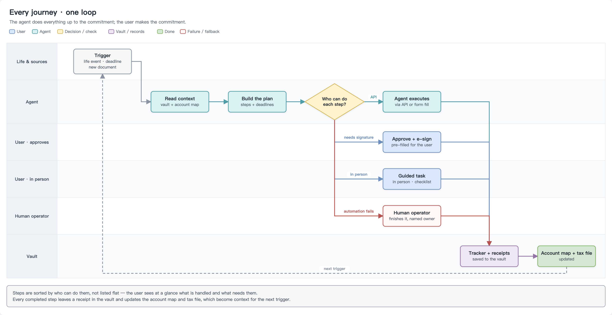](https://yg674-dev.github.io/life-admin-agent/docs/flows/00-core-loop.html)

The principle the chart encodes: **the agent does everything up to the commitment, and the user
makes the commitment.** Steps are sorted by who can do them, not listed flat, so the user sees at a
glance what is already handled and what needs them.

### J0 · Onboarding and verification

[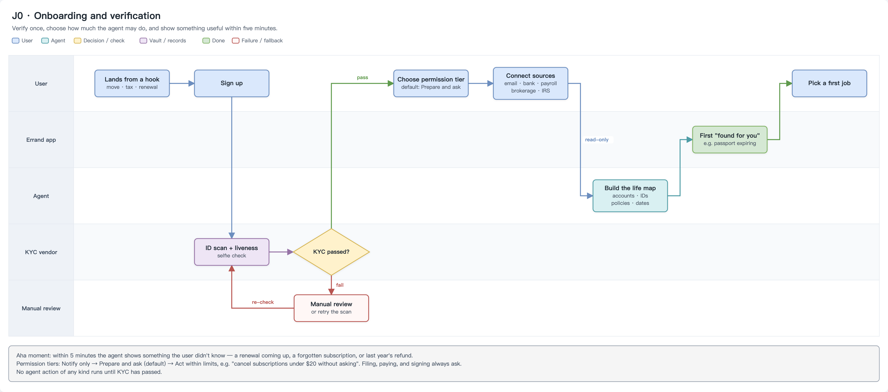](https://yg674-dev.github.io/life-admin-agent/docs/flows/01-onboarding.html)

- **Aha moment:** within 5 minutes the agent shows something the user didn't know — a renewal
  coming up, a forgotten subscription, or last year's refund they could have increased.
- **Permission tiers:** *Notify only* → *Prepare and ask* (default) → *Act within limits*, e.g.
  "cancel subscriptions under $20 without asking."

### J1 · Move — change my address everywhere

[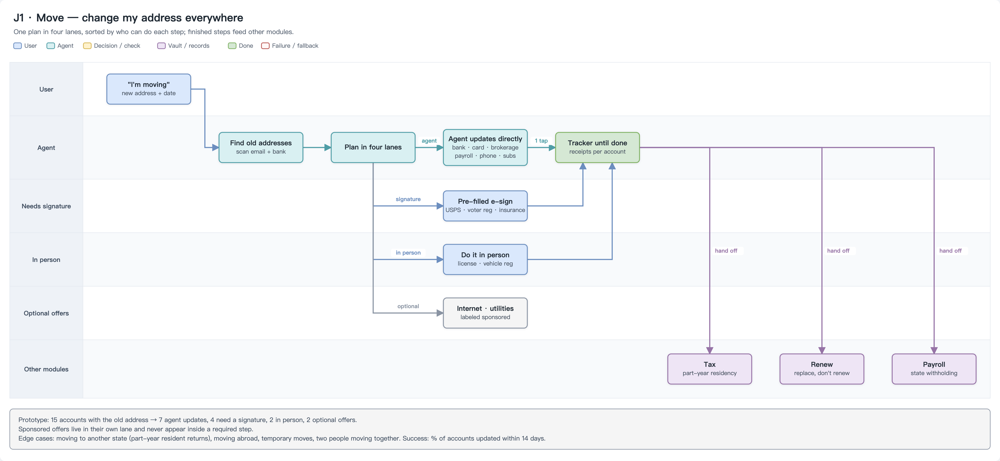](https://yg674-dev.github.io/life-admin-agent/docs/flows/02-move.html)

- **Edge cases:** moving to another state (part-year resident returns), moving abroad, temporary
  moves, two people moving together.
- **Success:** % of accounts updated within 14 days; partner offers accepted.

### J2 · Renew — never miss an expiry

[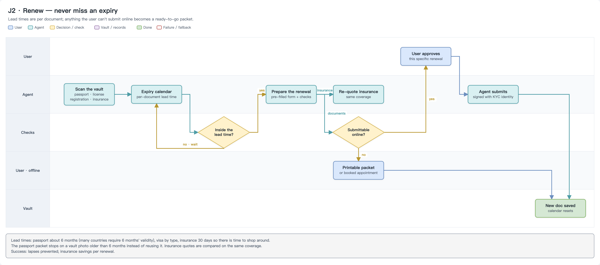](https://yg674-dev.github.io/life-admin-agent/docs/flows/03-renew.html)

- **Lead times:** passport about 6 months (many countries require 6 months' validity), visa by
  type, insurance 30 days so there is time to shop around.
- **Success:** lapses prevented; insurance savings per renewal.

### J3 · Claim — get my money back

[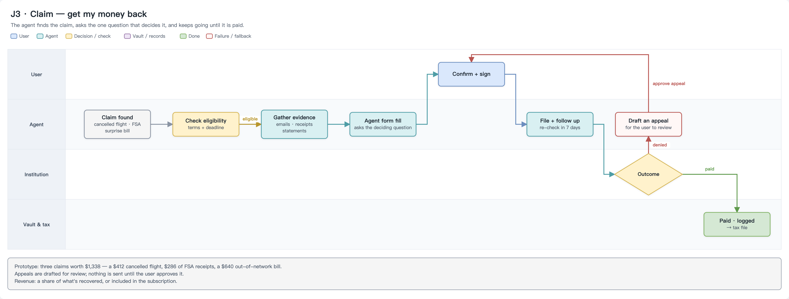](https://yg674-dev.github.io/life-admin-agent/docs/flows/04-claim.html)

- **Revenue:** a share of what's recovered, or included in the subscription.

### J4 · Tax — a year-round copilot

[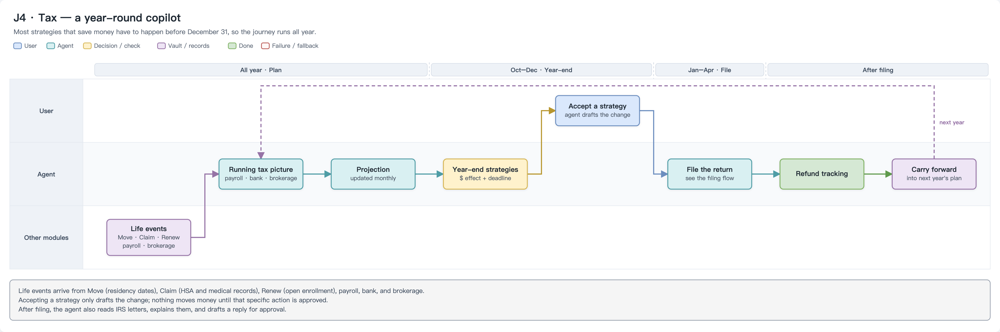](https://yg674-dev.github.io/life-admin-agent/docs/flows/05-tax-year-round.html)

Most strategies that save money have to happen **before** December 31 — the opposite of how
filing software works today. That is why the journey runs all year.

**Filing, in detail**

[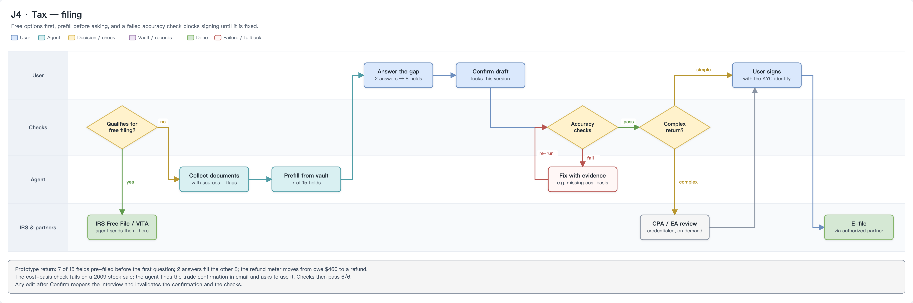](https://yg674-dev.github.io/life-admin-agent/docs/flows/06-tax-filing.html)

The interview behind *Answer the gap* runs in this order, and skips anything the vault already answers:

1. **Who are you this year?** — prefilled from the vault
2. **Income** — W-2, 1099-NEC / INT / DIV / B, gig platforms
3. **Life changes** — from Move, Renew, and Claim
4. **Deductions and credits** — the agent tests every one
5. **Choose a strategy** — side-by-side scenarios
6. **Accuracy check** — against the IRS transcript
7. **Plain-English summary** — what changed vs. last year
8. **Sign and file**

- **Free path:** if the user qualifies for IRS Free File or VITA, the agent says so up front.
- **Success:** minutes to file; questions asked per return; $ saved through strategies, shown and
  explained; users who come back next year.

**Life events → tax impact.** Each event recorded in another module becomes a prompt in the tax
file months before filing — the advantage of modules that feed each other.

| Event (source) | What the agent flags for tax | When it's raised |
| --- | --- | --- |
| Moved states (Move) | Part-year resident returns in both states; which state taxes which income | Right after the move |
| New job (email / payroll) | W-4 withholding across two jobs; old 401(k): roll over or leave | First payslip |
| Started gig work (bank) | Quarterly estimated payments; track business expenses; SEP or Solo 401(k) | First 1099 platform deposit |
| Baby / dependent (Renew) | Child tax credit, dependent care FSA, filing status, 529 | When the SSN card arrives |
| Married | Joint vs. separate; update W-4s; name change with SSA before filing | Name-change step |
| Medical claim (Claim) | Whether the medical deduction is worth it; HSA reimbursement records | When the claim is paid |
| Sold stock / crypto (brokerage) | Short- vs. long-term gains; offset with losses; wash-sale rules | At sale, and in Q4 |

### Ask Errand · always-on Q&A

[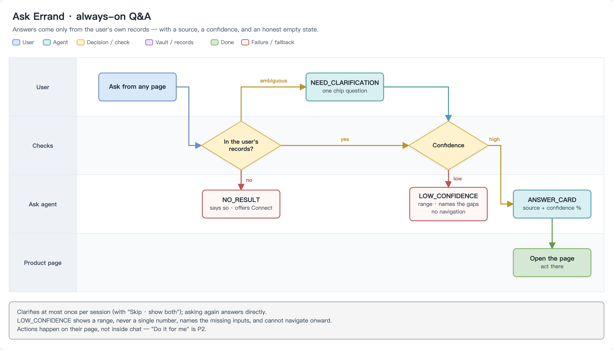](https://yg674-dev.github.io/life-admin-agent/docs/flows/07-ask-errand.html)

### Step by step

1. Maya signs up from a "moving soon" hook. She scans her license, passes liveness, keeps the
   default **Prepare and ask** tier, and connects email, bank, payroll, brokerage, and her IRS
   Online Account.
2. **Home** shows four things found for her: a move with 15 accounts to update, a passport that
   expires under six months before a trip, a $412 flight refund, and a projected $460 tax bill.
3. She asks **Ask Errand** about the passport and gets an answer card with its source and
   confidence; the card opens Renew. Asking about the home office triggers one clarifying question
   (job or freelance) before the answer.
4. In **Move**, she approves seven account updates in one tap. USPS forwarding opens the form-fill
   window: 4 of 8 fields are already filled; one answer about her roommate fills the rest and keeps
   the roommate's mail out of the forward.
5. **Renew** marks her Texas license as *replace*, not *renew*. Preparing the passport packet stops
   on a stale photo instead of reusing it.
6. **Claim** files the flight refund after one question — whether she accepted the rebooking or the
   voucher — which decides cash vs. credit.
7. **Tax** shows the move, her freelance income, and a March stock sale as life events. In
   year-end she accepts two strategies; each only drafts the change.
8. At filing, the agent checks free options, collects documents, pre-fills 7 of 15 fields, and asks
   two questions to fill the rest. Accuracy checks catch a missing cost basis; the agent finds the
   2009 trade confirmation in her email and asks to use it. Checks pass 6/6, she signs with her
   verified identity, and the return goes to the e-file partner.

## 7. F1 · Home

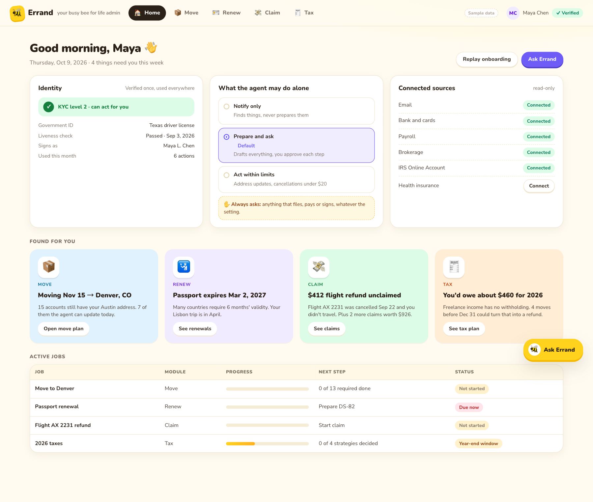

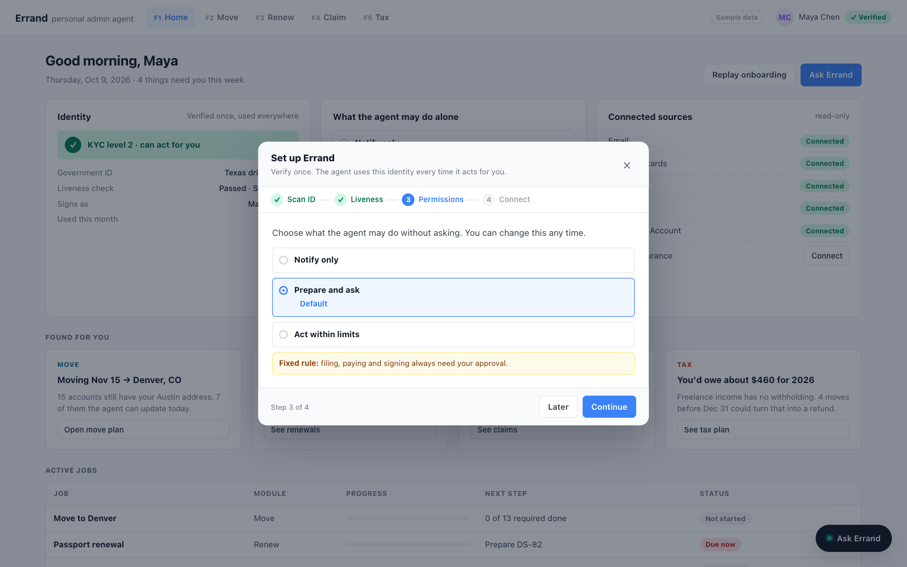

| Area | Behavior |
| --- | --- |
| **Identity** | KYC level, ID type, liveness date, the name the agent signs as, and how many actions used the identity this month |
| **Permission tiers** | *Notify only* · *Prepare and ask* (default) · *Act within limits* (address updates, cancellations under $20). Fixed rule shown on the card: filing, paying, signing always ask |
| **Connected sources** | Read-only connectors with status; unconnected sources show *Connect* |
| **Found for you** | One card per module with the finding, why it matters now, and a link into the module |
| **Active jobs** | Job, module, progress, next step, status — updated live by every module |
| **Replay onboarding** | ID scan → liveness → permissions → connect, as a four-step modal |

## 8. F1 · Ask Errand

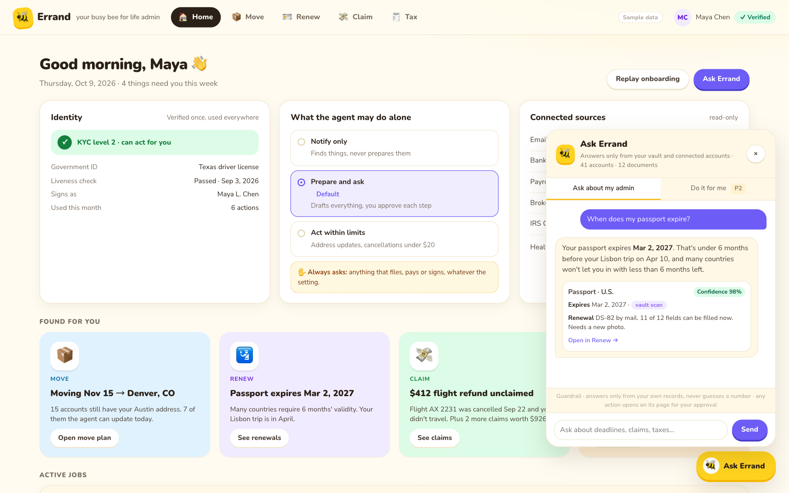

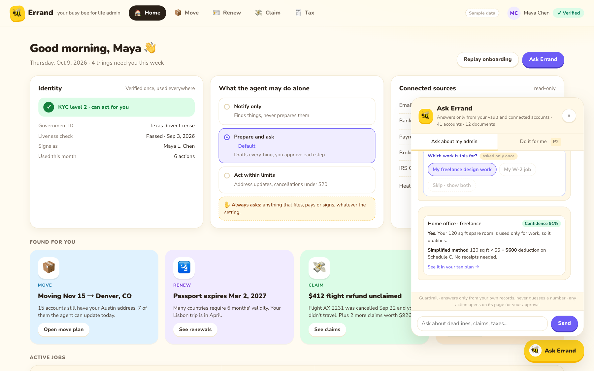

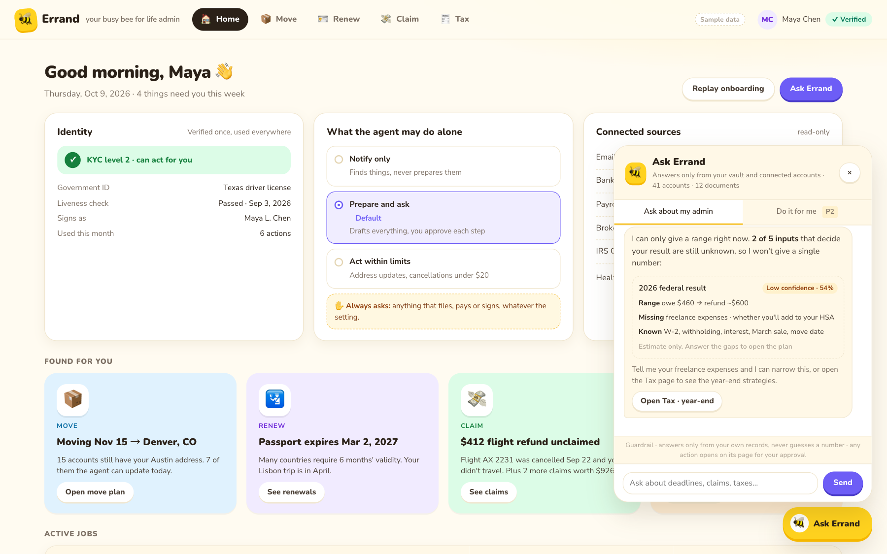

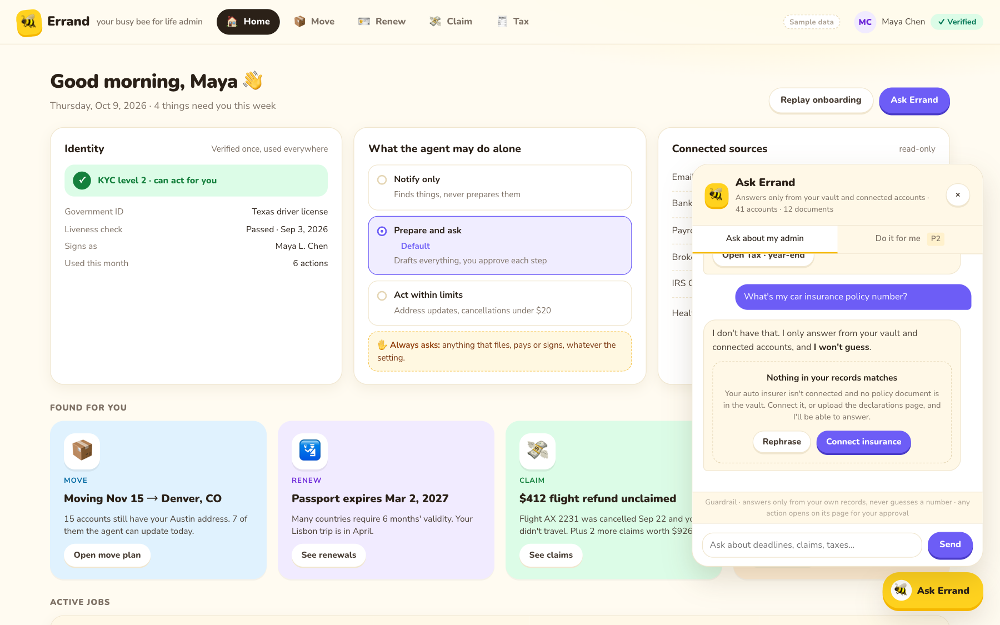

Always-on at the bottom right of every page, and from the Home header. Modeled on the
Feature Knowledge Library's Ask AI panel.

| State | Trigger | Behavior |
| --- | --- | --- |
| **`ANSWER_CARD`** | Answerable from the vault or connectors with high confidence | Short answer, then a card with the source tag, confidence %, and a link to the page where the action happens |
| **`NEED_CLARIFICATION`** | The answer differs by situation (e.g., home office for a W-2 job vs. freelance) | **At most one** chip-based question per session, with *Skip · show both*. Asking again answers directly |
| **`LOW_CONFIDENCE`** | Key inputs are missing | A **range**, never a single number; names the missing inputs; dashed card that **cannot navigate onward** |
| **`NO_RESULT`** | Nothing in the user's records answers it | States it won't guess, explains why (source not connected / no document), offers *Connect* or *Rephrase* |

**Guardrail:** answers come only from the user's own records. Actions are taken on their page, not
inside chat (*Do it for me* is P2).

## 9. Form-fill engine (shared by F2, F4, F5)

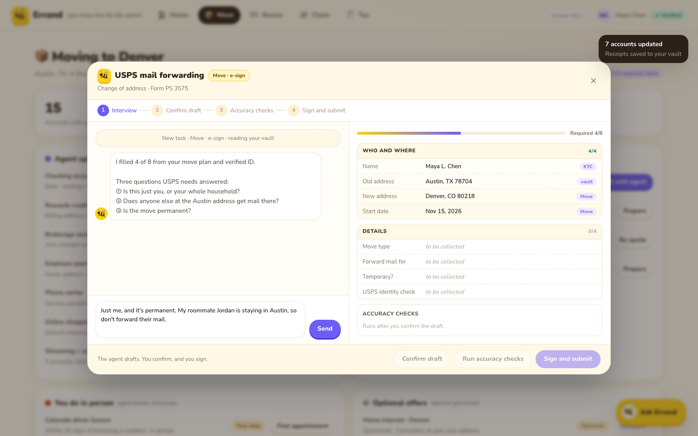

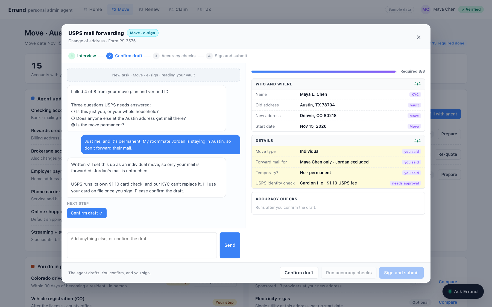

| Stage | Behavior |
| --- | --- |
| **1 · Interview** | The window opens with fields pre-filled from KYC, vault, and other modules, each tagged with its source. The agent asks only for what no document contains, in plain language, and injects each answer into the matching fields (yellow flash). `Required N/M` and per-section counts update live |
| **2 · Confirm draft** | Enabled at M/M. Locks the draft. Any later edit reopens the interview and invalidates the confirmation |
| **3 · Accuracy checks** | Run against IRS records, documents, and form rules. A failed check **blocks signing**; the agent asks a fix question, with evidence it found, then the checks must be re-run |
| **4 · Sign and submit** | The only step that commits the user. Signed with the KYC identity; receipts saved to the vault; the originating module updates |

| Form | Prefilled | Asked | Checks | Distinctive behavior |
| --- | --- | --- | --- | --- |
| USPS forwarding (PS 3575) | 4 / 8 | 1 answer → 4 fields | 4 | Asks who else lives there; forwards only consenting people's mail; discloses the USPS $1.10 card check KYC cannot replace |
| Flight refund | 5 / 8 | 1 answer → 3 fields | 4 | The one question that decides cash vs. credit |
| 2026 tax return (1040 · Sch C · Sch SE · CO DR 0104PN) | 7 / 15 | 2 answers → 8 fields | 6 | Live refund meter; itemized vs. standard shown; cost-basis check fails and is fixed with evidence |

## 10. F2 · Move

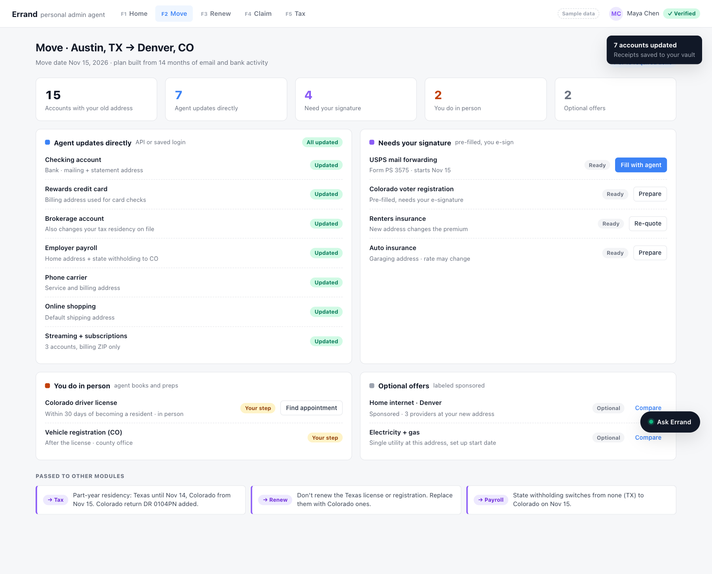

| Area | Behavior |
| --- | --- |
| **Summary** | 15 accounts with the old address: 7 agent updates, 4 need a signature, 2 in person, 2 optional offers |
| **Agent updates directly** | *Approve all 7* runs them as a batch; each row moves Ready → Updating → Updated with a receipt. Payroll also switches state withholding |
| **Needs your signature** | USPS opens the form-fill engine; renters insurance links to Renew's re-quote; the rest prepare an e-sign packet |
| **You do in person** | Colorado license (within 30 days of residency) with appointment booking and a document checklist; vehicle registration after the license |
| **Optional offers** | Labeled *sponsored*, separate lane, never inside a required step |
| **Passed to other modules** | Tax (part-year residency), Renew (replace, don't renew), Payroll (state withholding) |

## 11. F3 · Renew

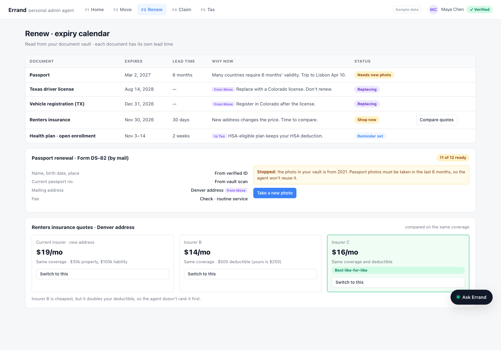

| Area | Behavior |
| --- | --- |
| **Expiry calendar** | Document, expiry, lead time, why now, status. Lead times are per document (passport 6 months, insurance 30 days) |
| **Cross-module status** | Documents the move makes obsolete show *Replacing*, not *Renew* |
| **Passport (DS-82)** | 11 of 12 fields prepared, mailing address from Move. **Stops** on a vault photo older than 6 months and asks for a new one |
| **Insurance re-quote** | Quotes compared on the same coverage. The cheapest quote is not ranked first when it doubles the deductible |

## 12. F4 · Claim

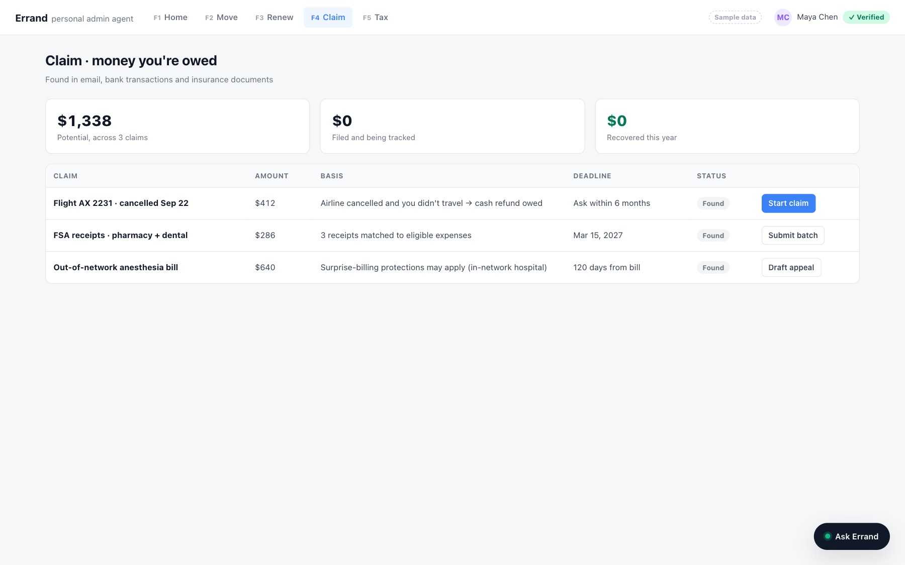

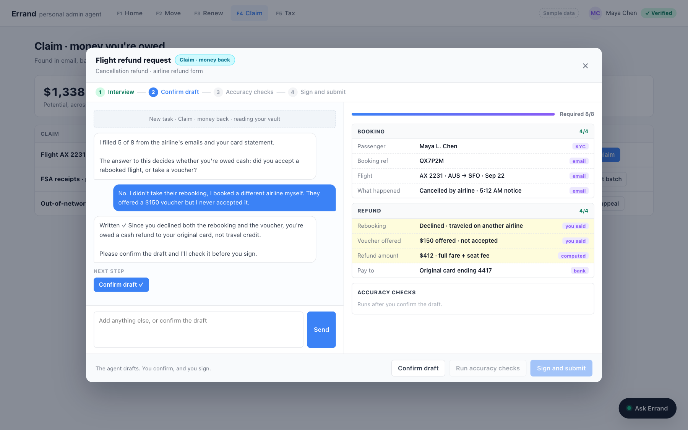

| Claim | Basis | Agent behavior |
| --- | --- | --- |
| Cancelled flight · $412 | Airline cancelled, user didn't travel → cash refund | Form-fill engine; follows up in 7 days, then drafts a DOT complaint |
| FSA receipts · $286 | Receipts matched to eligible expenses | Batch submit |
| Out-of-network bill · $640 | Surprise-billing protections may apply | Drafts an appeal for review; nothing is sent until approved |

## 13. F5 · Tax

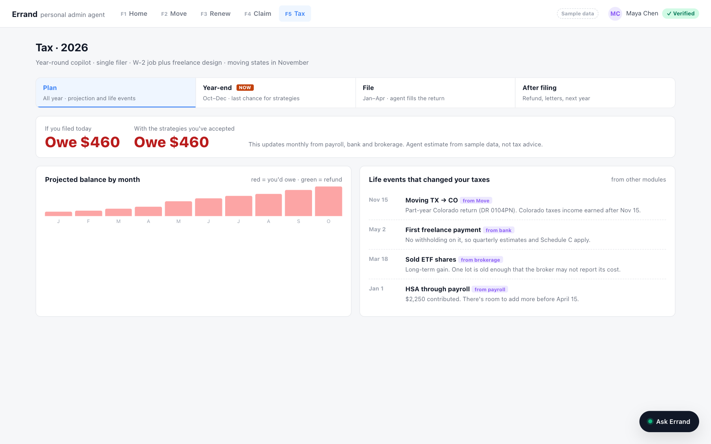

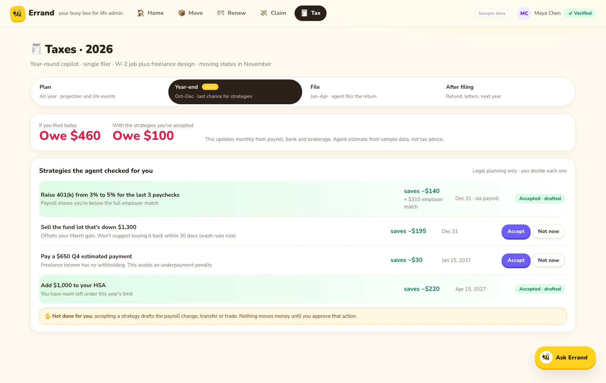

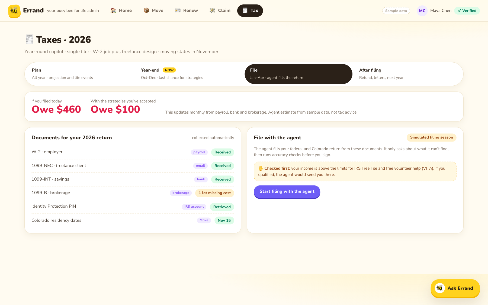

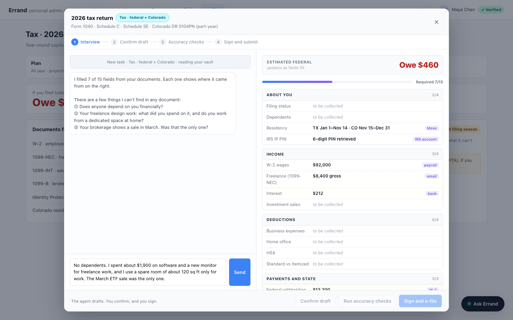

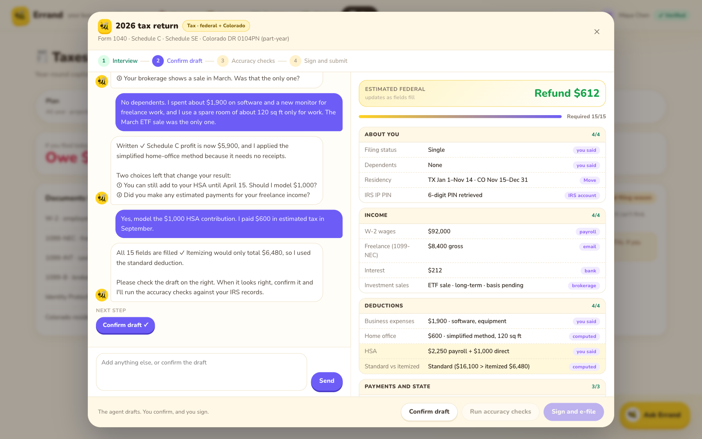

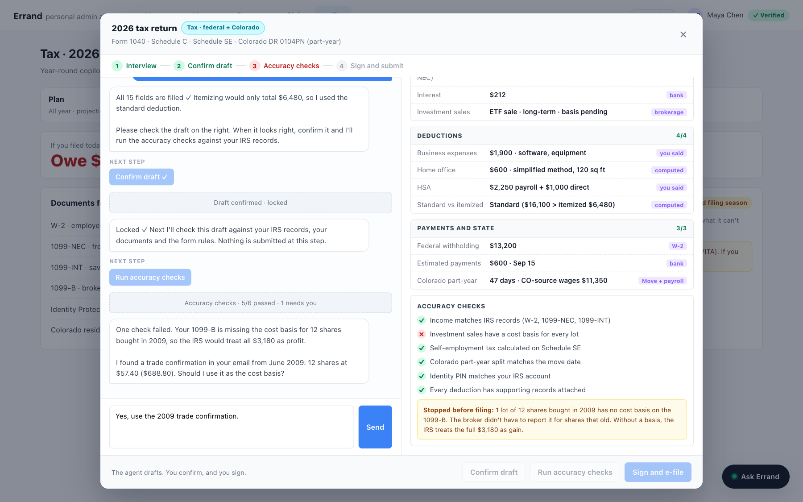

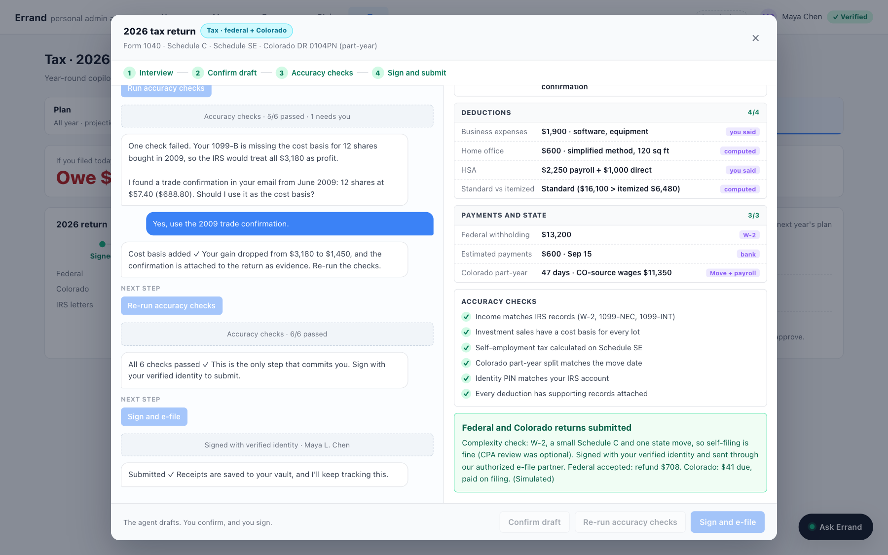

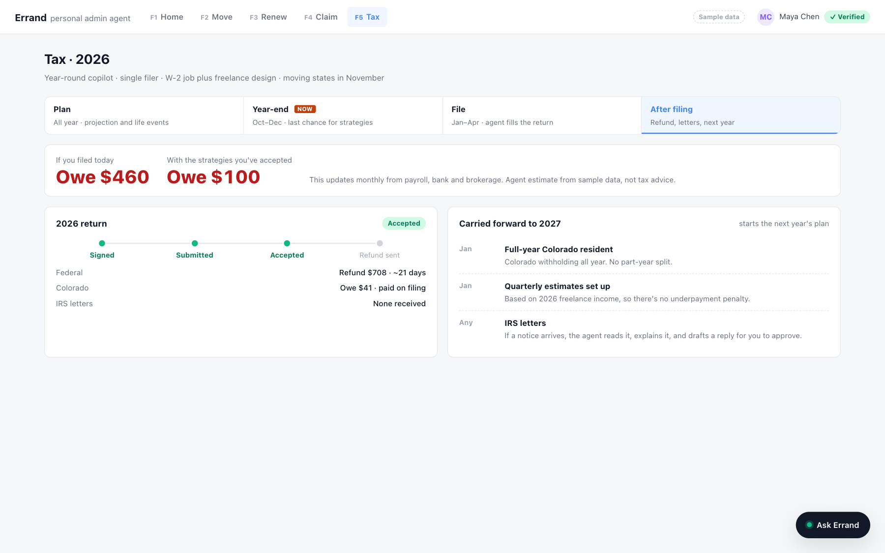

| Phase | Behavior |
| --- | --- |
| **Plan** (all year) | Projection by month; life events from Move, bank, brokerage, and payroll, each with its tax consequence |
| **Year-end** (Oct–Dec) | Strategies with trigger, $ effect, and deadline: 401(k) to full match, loss harvesting (wash-sale aware), Q4 estimate, HSA top-up. *Accept* drafts the change; nothing moves money until that action is approved |
| **File** (Jan–Apr) | Free File / VITA eligibility check first. Documents auto-collected with sources and flags (e.g., 1099-B missing basis). Filing runs the form-fill engine with a live refund meter |
| **After filing** | Refund tracking, IRS letter reader that drafts replies for approval, carry-forward to next year's plan |

**Smart tax strategies the agent checks.** Legal planning only — the agent tests each against the
user's data, shows the dollar effect, and leaves the decision to the user. Limits and credit rules
change every year, so the agent reads current-year figures rather than hardcoded numbers.

| Strategy | Who it helps | Agent's trigger | Deadline |
| --- | --- | --- | --- |
| Max 401(k) / 403(b) | Salaried with room under the limit | Payroll shows % below the match or the limit | Dec 31 (via payroll) |
| IRA (Traditional vs. Roth) | Most earners | Income vs. deduction and Roth phase-outs | Filing deadline |
| HSA contributions | People on a high-deductible health plan | Insurance doc shows an HDHP | Filing deadline |
| Fix W-4 withholding | Big refund or big bill last year | Projection off by more than a set amount | Any time, earlier is better |
| Quarterly estimates | Gig and self-employed | Untaxed 1099 income detected | Quarterly due dates |
| Itemize vs. standard | Homeowners, big donors, high medical costs | Sum of 1098 + charity + medical + SALT | At filing |
| Bunch donations / DAF | Givers near the itemizing line | Itemized total just below standard | Dec 31 |
| Tax-loss harvesting | Taxable brokerage with losses | Unrealized losses + realized gains | Dec 31 |
| Gain timing (0% bracket) | Low-income years, students, retirees | Projected income under the 0% capital-gains threshold | Dec 31 |
| Credits sweep | Families, students, low-to-moderate income | EITC, Child Tax Credit, AOTC / LLC, Saver's Credit, dependent care | At filing |
| Filing status test | Married, single parents | Joint vs. separate, Head of Household eligibility | At filing |
| Self-employed deductions | Freelancers | Home office, mileage, health premiums, SEP / Solo 401(k) | Dec 31 / filing |
| 529 state deduction | Parents in states that offer it | Child in household + state rules | Varies by state |
| Amend past returns | Anyone who missed a credit | Last 3 years' returns reviewed against found data | 3-year window |

**Learning from Intuit.** Kept: interview over forms, document import, a live refund meter, a final
accuracy review, expert review on demand. Changed: year-round instead of seasonal; one clear price
instead of upgrade prompts mid-flow; infer before asking; explain choices with scenarios; tax data
used only for tax preparation.

## 14. Backend data contract

| Object | Required fields | Notes |
| --- | --- | --- |
| **Identity** | `user_id`, `kyc_level`, `id_document_type`, `liveness_passed_at`, `legal_name`, `signing_key_ref` | ID images retained only as long as the KYC vendor requires |
| **Permission** | `tier` (`notify` / `prepare` / `act_within_limits`), `limits` (amount caps, action types), `always_ask` (`file`, `pay`, `sign` — not editable) | Every action is checked against this before execution |
| **Account map** | `institution`, `account_type`, `address_on_file`, `update_channel` (`api` / `browser` / `esign` / `in_person`), `last_verified_at` | Built from connector scans; drives Move lanes |
| **Document vault** | `doc_type`, `issued_at`, `expires_at`, `extracted_fields`, `source` | Drives Renew lead times and form prefill |
| **Life event** | `event_type`, `date`, `source_module`, `tax_impacts[]` | How Move, Claim, and Renew feed Tax |
| **Form draft** | `form_id`, `version`, `fields{value, source, filled_at}`, `required_filled`, `required_total`, `confirmed_version`, `checks[]`, `status` | A new answer creates a new version and invalidates prior confirm and checks |
| **Submission** | `form_id`, `version`, `signed_by`, `signed_at`, `channel`, `receipt`, `follow_up_at` | Only the latest confirmed, check-passed version can be submitted |

## 15. Status and error codes

| Code | Meaning | Raised by | UX |
| --- | --- | --- | --- |
| `KYC_FAILED` | ID or liveness did not pass | KYC vendor | Retry or manual review; no agent actions until verified |
| `APPROVAL_REQUIRED` | Action is in the always-ask set or above tier limits | Permission service | Draft prepared; user approves the specific action |
| `PREFILL_PARTIAL` | Some required fields have no source | Engine | Agent asks only for those fields |
| `CHECK_FAILED` | An accuracy check failed | Engine | Signing blocked; fix question with evidence; re-run required |
| `CHECKS_PASSED` | All checks passed | Engine | Sign enabled. **Nothing submitted yet** |
| `STALE_EVIDENCE` | A document is too old for the form (e.g., passport photo > 6 months) | Engine | Stop and request a new one; never reuse |
| `VENDOR_STEP_REQUIRED` | The institution requires its own verification (e.g., USPS card check) | Engine | Disclose it and ask approval; don't claim KYC covers it |
| `HANDOFF_HUMAN` | Automation failed or the case is complex | Engine / Ops | Named human operator or CPA/EA takes over |
| `ANSWER_CARD` / `NEED_CLARIFICATION` / `LOW_CONFIDENCE` / `NO_RESULT` | Ask Errand response states | Ask agent | See §8 |

## 16. Compliance and permission model

- **E-filing** requires IRS authorized e-file provider status (EFIN) or a partner who holds it.
- **Paid preparation:** if the product charges to prepare returns, reviewing CPAs/EAs need PTINs and
  the product must follow preparer rules. Decide early: self-prepared software, or a preparation service.
- **Tax data** is used only for tax preparation unless the user consents (IRC §7216).
- **The user always signs.** No filing, payment, or signature without approval of that action.
- **Audit trail:** every agent action logs who approved it, the tier in force, the draft version, and
  the receipt.
- A tax attorney reviews the product before the pilot.

## 17. Competitive landscape

| Player | What it does | Where it stops |
| --- | --- | --- |
| **Intuit TurboTax** | Interview-style consumer tax filing, expert help tiers | Seasonal; knows nothing about the user's year; upsell-driven pricing |
| **Town** | Began as AI + accountant tax service for small businesses; now a general work assistant ("Townies") | Business and work focus; no consumer life admin or verified-identity actions |
| **IRS Free File / VITA** | Free filing for eligible incomes | Filing only; no planning, no other admin. *Errand routes eligible users here* |
| **General AI agents** | Email, scheduling, browsing tasks | No verified identity, no scoped permission to sign, no institution-specific checks or liability |
| **Checklists / reminder apps** | Track deadlines | Cannot act |

The defensible parts are the ones general agents lack: verified identity, scoped legal permission to
act, institution-specific forms with checks, and accountability for what is submitted.

## 18. Rollout

| Phase | Scope | Exit criteria |
| --- | --- | --- |
| **Phase 0 · Pilot** | Onboarding, Home, Ask Errand, Move (US, 2 states) | ≥ 50% of required move steps completed through the agent · zero unapproved submissions · KYC pass rate measured |
| **Phase 1** | Renew + Claim on the shared engine | Each new form ships as config only · `CHECK_FAILED` caught pre-submission > post-submission rejections |
| **Phase 2** | Tax year-round + filing with e-file partner, CPA/EA review for complex returns | Filing-season NPS · post-filing IRS notices below baseline · strategies accepted before deadline |
| **Phase 3** | *Do it for me* from Ask Errand; more states and life events | Action-from-chat approval rate without increase in reversals |

## 19. Open questions

1. **Market** — US first? A China or EU launch changes the tax engine and every government integration. *Owner: founders.*
2. **E-file** — build an EFIN-holding operation or partner? *Owner: Tax lead + Legal.*
3. **Pricing** — one subscription for all modules, or a free agent with a paid filing tier? *Owner: PM + Finance.*
4. **Identity** — does the existing KYC satisfy IRS identity requirements, or do users still verify with the IRS separately? *Owner: Compliance.*
5. **First module to ship** — Move as the wedge, or Tax timed to the next filing season? *Owner: PM.*
6. **Name** — "Errand" is a placeholder. *Owner: founders.*

## 20. What's in this repo

| Path | What it is |
| --- | --- |
| [`demo/index.html`](https://yg674-dev.github.io/life-admin-agent/demo/) | **Live demo** — prototype + 23-step guided walkthrough |
| [`index.html`](https://yg674-dev.github.io/life-admin-agent/) | The prototype on its own |
| [`demo/build.py`](demo/build.py) | Generates `demo/index.html` by injecting the walkthrough layer into the untouched prototype |
| [Journey map](https://life-admin-agent-map.vercel.app/) · [`docs/journey-map.html`](https://yg674-dev.github.io/life-admin-agent/docs/journey-map.html) | Journey map: all journeys, life events → tax, Intuit lessons, strategy table (the Vercel deployment and the in-repo copy are the same page) |
| [`docs/flows/`](docs/flows/) | Swimlane user-journey charts used in §6: HTML source + PNG per journey. Rebuild with `python3 docs/flows/build.py` |
| `docs/screens/` | Per-feature screenshots used above |

```bash
git clone https://github.com/yg674-dev/life-admin-agent.git
cd life-admin-agent
open demo/index.html        # after editing index.html: python3 demo/build.py
```

Self-contained HTML — no build step, no server, no backend.
